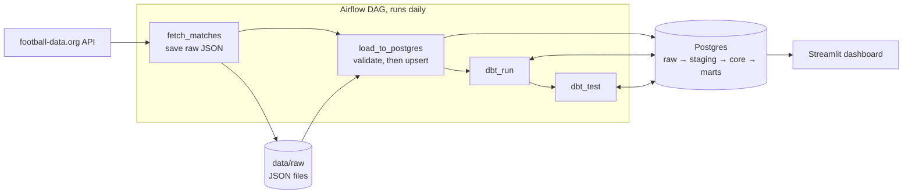
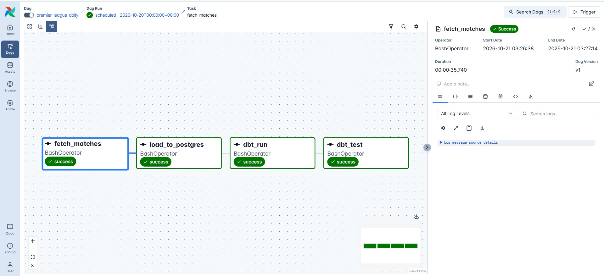
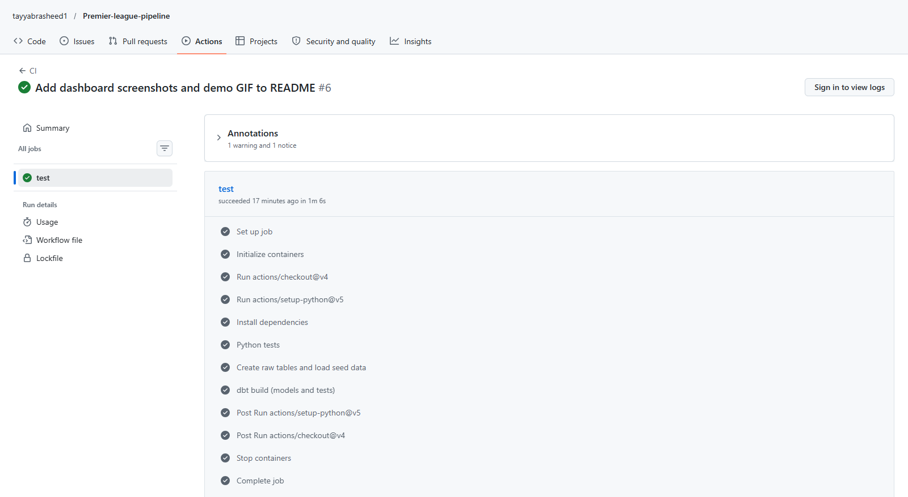
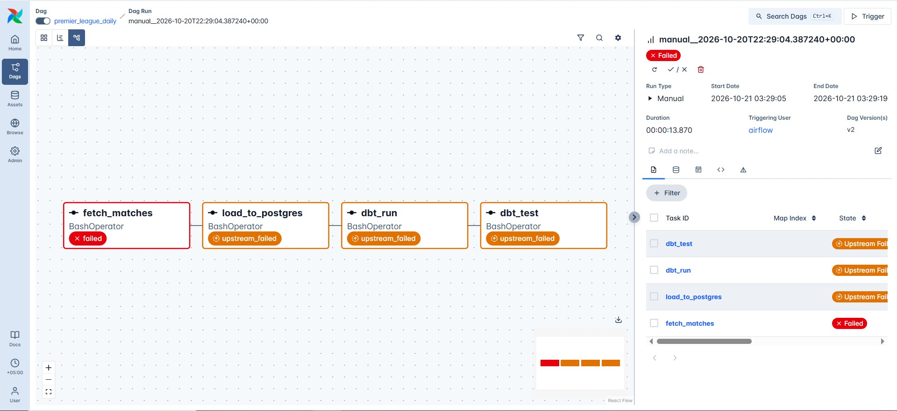

# Premier League Data Pipeline


A production-style data pipeline that pulls Premier League match data from the
[football-data.org](https://www.football-data.org/) API every day, stores the raw
JSON untouched, loads it into Postgres, transforms it with dbt into analytics
tables, and serves a dashboard. It is built to be safe to rerun: loading the same
data twice never creates duplicates, and corrected scores or postponed matches
update rows in place.

The dataset is small (1,140 matches across 3 seasons, 2023/24 to 2025/26). The
point of the project is the engineering around it, not the data volume.


## Architecture



| Layer | Tool | Why |
| --- | --- | --- |
| Ingestion | Python, requests | Simple, with retries on rate limits and server errors |
| Raw storage | JSON files, partitioned by season and fetch date | Raw data is never overwritten, so any load can be replayed |
| Warehouse | Postgres 16 | Free, widely used, supports `INSERT ... ON CONFLICT` |
| Transform | dbt | Versioned SQL models with built-in tests |
| Orchestration | Airflow | Daily schedule, retries, failure alerts (optional Slack webhook) |
| Quality | Pydantic, dbt tests, pytest, GitHub Actions | Bad data fails loudly instead of loading silently |
| Serving | Streamlit | Fast way to show the marts |
| Packaging | Docker Compose | One command starts Postgres, Airflow and the dashboard |



### dbt models


| Layer | Materialized as | Models |
|---|---|---|
| staging | views | `stg_matches`, `stg_teams`: cleaned, renamed copies of the raw tables |
| core | tables | `dim_teams`, `dim_seasons`, `fact_matches` (one row per match), `fact_team_matches` (one row per team per finished match) |
| marts | tables | `league_table`, `team_form_last_5`, `home_vs_away_performance`, `goals_for_against_rolling` |

## Design decisions

- **Idempotent loads.** Matches are upserted on `match_id`, and a row is only
  rewritten if its content actually changed. Running the pipeline twice changes
  nothing. `tests/test_idempotency.py` proves this, including a corrected score
  and a postponed match.
- **Schema check before loading.** Each match is validated with Pydantic
  (`ingest/validate.py`). If the API renames a field or changes a type, the bad
  records are copied to `data/quarantine/`, the load stops, and the Airflow task
  fails. Nothing from that file is written, not even the good records. Extra new
  fields are allowed, because they are harmless.
- **Raw, staging, core, marts.** Raw tables keep the original JSON, so no
  information is lost. dbt builds clean staging views, then core tables, then
  the marts the dashboard reads.
- **Data tests.** 14 dbt tests cover uniqueness, nulls, valid match statuses,
  foreign keys to `dim_teams`, no negative scores, finished matches having
  scores, and "every team plays 38 matches in a complete season".
- **CI on every push.** GitHub Actions runs pytest and `dbt build` on a clean
  machine with a small seeded dataset (`sql/ci_seed.sql`), so it never calls
  the real API.
- **Backfill with the same code.** `ingest/backfill.py` loops over a season
  range and calls the same fetch and load functions as the daily DAG, so
  history and daily loads can't drift apart.
- **Airflow in standalone mode.** I chose the single-container setup to keep it
  light on a laptop. A real deployment would use the official multi-container
  setup or a managed service.

## Run it

You need Docker and a free API key from football-data.org.

```bash
git clone https://github.com/tayyabrasheed1/Premier-league-pipeline.git
cd Premier-league-pipeline
cp .env.example .env        # then add your API key to .env
docker compose up -d --build
```

On the first start, Postgres creates the Airflow database and the raw tables by
itself (`sql/000_create_airflow_db.sql`, `sql/001_create_raw_tables.sql`).

1. Open Airflow at http://localhost:8080, unpause `premier_league_daily`, and trigger it.
2. When the four tasks are green, open the dashboard at http://localhost:8501.
   Before the first run it shows "No data yet" instead of an error.

Optional, to load several seasons of history:

```bash
docker compose exec -w /opt/airflow/project airflow python -m ingest.backfill --from-season 2023 --to-season 2025
docker compose exec -w /opt/airflow/project/dbt_project airflow /opt/airflow/dbt_venv/bin/dbt build --profiles-dir .
```

The free API tier may not include every season. A season the API refuses is
reported and skipped. In Git Bash on Windows, run `export MSYS_NO_PATHCONV=1`
first, or use PowerShell (see "What broke" below).

I tested these steps from a fresh clone with an empty database.

## Develop and test locally

```bash
python -m venv venv
venv\Scripts\activate          # Windows; use source venv/bin/activate elsewhere
pip install -r requirements.txt
docker compose up -d postgres

python -m ingest.fetch_matches --season 2025
python -m ingest.load_matches --season 2025
cd dbt_project && dbt build --profiles-dir . && cd ..
streamlit run dashboard/app.py

pytest -v                      # 8 tests
```

The tests create and drop their own `premier_league_test` database, so they
never touch your real data.

## Proving the checks work

A test you've never seen fail isn't proven, so I broke each layer on purpose.

**Idempotency tests.** I removed the `WHERE raw.matches.raw_json IS DISTINCT FROM
EXCLUDED.raw_json` check from the match upsert. Two tests failed: loading the
same file twice reported 3 rows changed instead of 0, and correcting one match's
score rewrote all 3 rows instead of 1. Restoring the check made all tests pass.

**dbt tests.** I set one match's score to -1 in the raw table and ran `dbt build`:


**CI.** I pushed a branch that removed `FINISHED` from the allowed statuses. The
run went red at `dbt build`, while `main` stays green:

| Deliberate failure | Normal run on main |
|---|---|
|  |  |

**Airflow.** When a task fails, the tasks after it don't run, and the failure
callback sends an alert:



## Schema-change demo

I simulated the API renaming `id` to `match_id` on 3 records, by editing them in
memory before validation. The check stopped the load before anything was
written and quarantined the bad records. This is a simulated failure, not a real
incident from the API.

```text
CIRCUIT BREAKER TRIPPED
3 of 380 records in data\raw\matches\season=2025\...\matches_20261101T021953.json failed validation.
Quarantined to data\quarantine\matches_20261101T025115.json. First error: 1 validation error for Match
id
  Field required [type=missing, input_value={'area': {'id': 2072, 'na...'}], 'match_id': 537785}, input_type=dict]
```

## Dashboard

A Streamlit app (`dashboard/app.py`) reads the marts and shows, for any loaded
season, the league table with form badges, a team view with the last 5 results,
home vs away points per game, and rolling 5-match goals. All queries use bound
parameters, and results are cached for 5 minutes.


| Team view | Home vs away and rolling goals |
|---|---|
|  |  |

## What broke and how I fixed it

| Problem | Cause | Fix |
| --- | --- | --- |
| The rolling 5-match average at the start of a season included matches from the previous season (Arsenal's first 2024/25 match showed 2.20 goals instead of 2.00) | The window function was partitioned by team only | Partition by team and season |
| The dashboard's team picker reset, and in tests crashed, when the season changed | Giving the selectbox a computed default made Streamlit treat it as a new widget on every season change | Store the choice in session state with a fixed key, and fall back to the league leader only when the team wasn't in that season |
| A fresh clone needed manual setup before Airflow could start | The Airflow database and raw tables were created by hand | Postgres init scripts in `docker-entrypoint-initdb.d` create them on the first start |
| `docker compose exec -w /opt/airflow/project ...` failed with "Cwd must be an absolute path" | Git Bash on Windows rewrites arguments that start with `/` into Windows paths | `export MSYS_NO_PATHCONV=1`, or run the command in PowerShell |
| CI showed a Node.js deprecation warning and dbt showed a test-syntax deprecation warning | `actions/checkout@v4` and `setup-python@v5` run on Node 20; newer dbt expects test arguments under `arguments:` | Upgraded to `checkout@v5` and `setup-python@v6`, and moved the test arguments |

## Querying the results

```bash
docker compose exec postgres psql -U pl_user -d premier_league \
  -c "SELECT position, team_name, played, points FROM marts.league_table WHERE season = 2025 ORDER BY position;"
```

## Limitations

- Small dataset on a single machine, so this is not a big-data project.
- Airflow standalone is not a production setup.
- `raw.teams` has one row per team, so each season's load overwrites a team's
  details with that season's version. Matches are unaffected, but a backfill
  rerun reports team updates even when nothing really changed.
- The dashboard uses the same database user as the pipeline. A real deployment
  would use a read-only user, so a dashboard bug could never change data.
- No streaming. Data is loaded in daily batches.

## Possible next steps

- Key `raw.teams` by team and season, so team details are kept per season and
  reruns report zero changes.
- Give the dashboard its own read-only database user.
