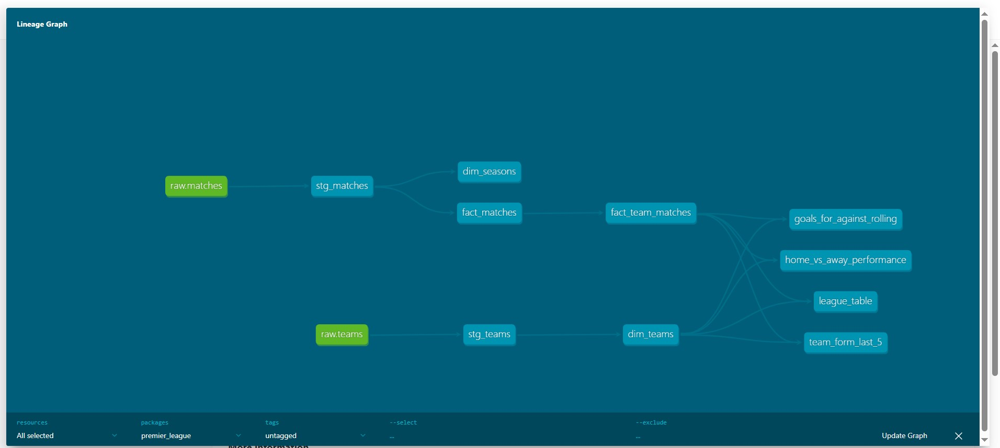

# Premier League Pipeline

An end-to-end data pipeline for Premier League results. Match and team data is pulled from the [football-data.org](https://www.football-data.org/) API, loaded into Postgres, and modelled with dbt into tables that power a league table, team form and home/away analysis.

## Architecture

```
football-data.org API
        │  ingest/fetch_matches.py
        ▼
data/raw/*.json            (raw API responses, partitioned by season and fetch date)
        │  ingest/load_matches.py  (idempotent upsert)
        ▼
Postgres: raw schema       (raw.matches, raw.teams)
        │  dbt
        ▼
staging → core → marts
```

## dbt lineage



| Layer | Materialized as | Models |
|---|---|---|
| staging | views | `stg_matches`, `stg_teams`: cleaned, renamed copies of the raw tables |
| core | tables | `dim_teams`, `dim_seasons`, `fact_matches` (one row per match), `fact_team_matches` (one row per team per finished match) |
| marts | tables | `league_table`, `team_form_last_5`, `home_vs_away_performance`, `goals_for_against_rolling` |

## Tech stack

Python · PostgreSQL 16 (Docker) · dbt-postgres

## Running it locally

Prerequisites: Docker, Python 3, and a free football-data.org API key.

```bash
# 1. Configure
cp .env.example .env          # then add your FOOTBALL_DATA_API_KEY

# 2. Start Postgres and create the raw tables
docker compose up -d
docker compose exec postgres psql -U pl_user -d premier_league -f /sql/001_create_raw_tables.sql

# 3. Python environment
python -m venv venv
venv\Scripts\activate          # Windows; use source venv/bin/activate elsewhere
pip install -r requirements.txt

# 4. Ingest a season
python ingest/fetch_matches.py --season 2025
python ingest/load_matches.py --season 2025

# 5. Build and test the models
cd dbt_project
dbt run --profiles-dir .
dbt test --profiles-dir .
```

## Querying the results

```bash
docker compose exec postgres psql -U pl_user -d premier_league \
  -c "SELECT position, team_name, played, points FROM marts.league_table WHERE season = 2025 ORDER BY position;"
```
