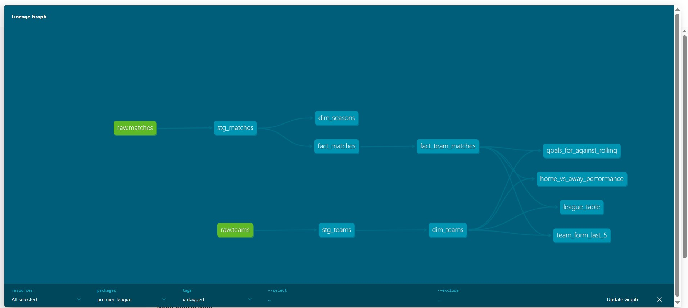
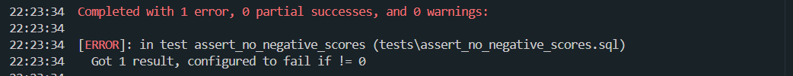
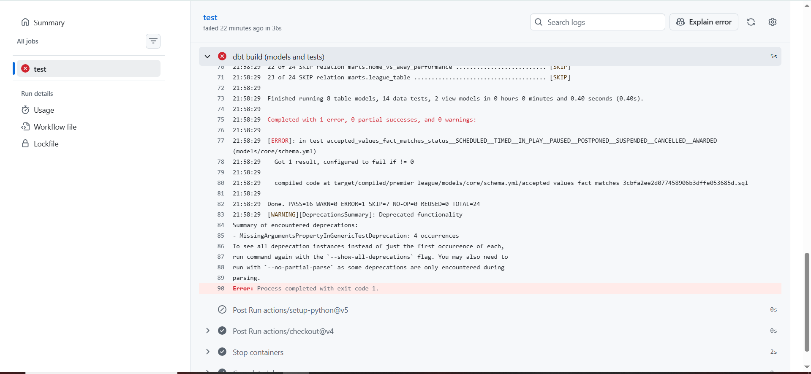
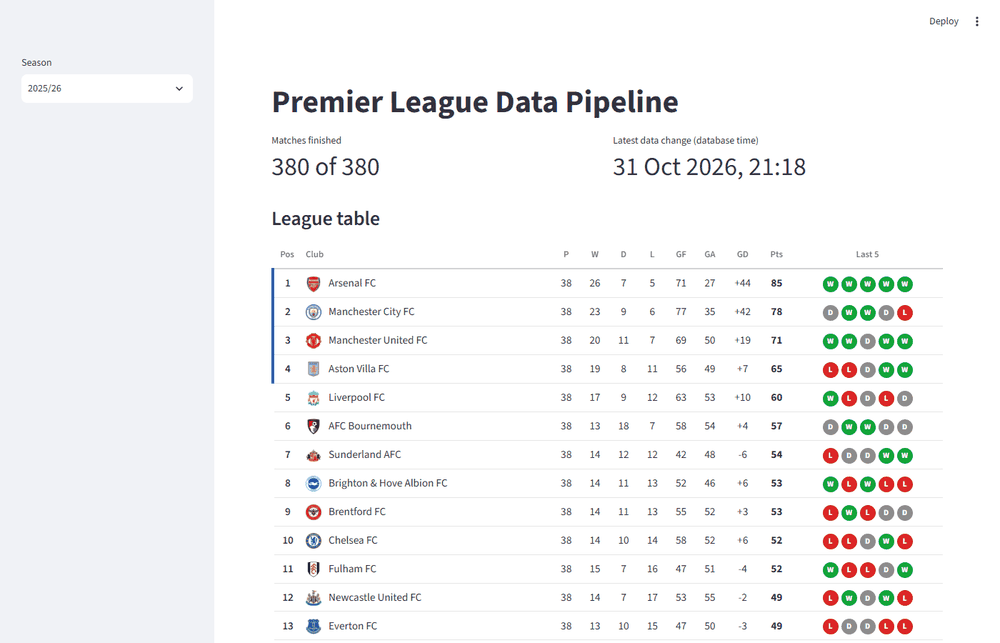
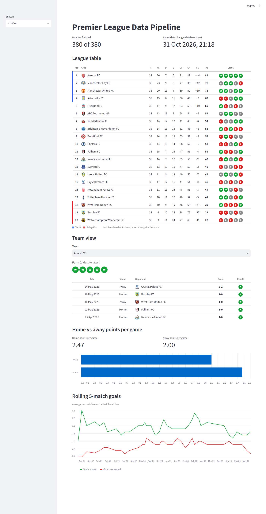
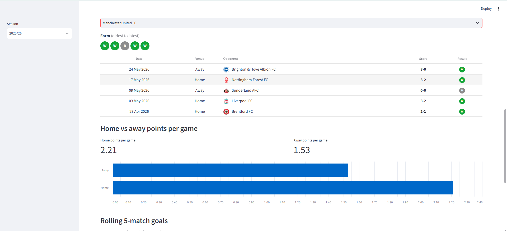
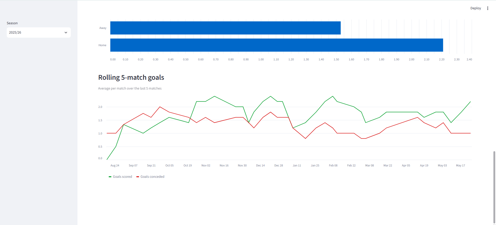

# Premier League Pipeline


An end-to-end data pipeline for Premier League results. Match and team data is pulled from the [football-data.org](https://www.football-data.org/) API, loaded into Postgres, and modelled with dbt into tables that power a league table, team form and home/away analysis.

## Architecture

```
football-data.org API
        │  ingest/fetch_matches.py
        ▼
data/raw/*.json            (raw API responses, partitioned by season and fetch date)
        │  ingest/load_matches.py  (idempotent upsert)
        ▼
Postgres: raw schema       (raw.matches, raw.teams)
        │  dbt
        ▼
staging → core → marts
```

## dbt lineage



| Layer | Materialized as | Models |
|---|---|---|
| staging | views | `stg_matches`, `stg_teams`: cleaned, renamed copies of the raw tables |
| core | tables | `dim_teams`, `dim_seasons`, `fact_matches` (one row per match), `fact_team_matches` (one row per team per finished match) |
| marts | tables | `league_table`, `team_form_last_5`, `home_vs_away_performance`, `goals_for_against_rolling` |

## Tech stack

Python · PostgreSQL 16 (Docker) · dbt-postgres · Airflow · Pydantic · pytest · GitHub Actions · Streamlit

## Running it locally

Prerequisites: Docker, Python 3, and a free football-data.org API key.

```bash
# 1. Configure
cp .env.example .env          # then add your FOOTBALL_DATA_API_KEY

# 2. Start Postgres and create the raw tables
docker compose up -d
docker compose exec postgres psql -U pl_user -d premier_league -f /sql/001_create_raw_tables.sql

# 3. Python environment
python -m venv venv
venv\Scripts\activate          # Windows; use source venv/bin/activate elsewhere
pip install -r requirements.txt

# 4. Ingest a season
python -m ingest.fetch_matches --season 2025
python -m ingest.load_matches --season 2025

# 5. Build and test the models
cd dbt_project
dbt run --profiles-dir .
dbt test --profiles-dir .
```

## Backfilling historical seasons

Fetch and load multiple seasons with the same functions used by the daily pipeline:

```bash
python -m ingest.backfill --from-season 2023 --to-season 2025
```

The range is inclusive. Seasons the API refuses with an HTTP error are reported and skipped; other failures stop the command. The existing single-season fetch/load commands and Airflow DAG remain unchanged.

To test that loading is idempotent, start Postgres and run:

```bash
pytest -v
```

The tests recreate the dedicated `premier_league_test` database for each test. Ensure `POSTGRES_DB` is set to your regular database, not `premier_league_test`; the fixture refuses to run if they match.

**Proving the tests work:** I temporarily removed the `WHERE raw.matches.raw_json IS DISTINCT FROM EXCLUDED.raw_json` check from the match upsert. Two tests failed: loading the same file twice reported 3 rows changed instead of 0, and correcting one match's score rewrote all 3 rows instead of 1. Restoring the check made all 3 tests pass again.

## Data quality and CI

Bad data is stopped at two points:

- **Before loading:** every match in a raw file is validated against a Pydantic model (`ingest/validate.py`). If the API renames a field or changes a type, the bad records are copied to `data/quarantine/`, the load stops, and nothing from that file is written.
- **After dbt runs:** dbt tests check uniqueness, nulls, allowed match statuses, that every match points to a known team, and custom rules (no negative scores, finished matches have scores, 38 matches per team in a complete season).

To prove the dbt tests catch bad data, I set one match's score to -1 in the raw table and ran `dbt build`:



Every push runs GitHub Actions (`.github/workflows/ci.yml`): a fresh Postgres, `pytest`, then `dbt build` on a small seed dataset (`sql/ci_seed.sql`). To prove CI fails when it should, I pushed a branch that removed `FINISHED` from the allowed statuses, and the run went red at `dbt build`:



## Querying the results

```bash
docker compose exec postgres psql -U pl_user -d premier_league \
  -c "SELECT position, team_name, played, points FROM marts.league_table WHERE season = 2025 ORDER BY position;"
```

## Dashboard

A Streamlit app (`dashboard/app.py`) reads the mart tables and shows, for any loaded season:

- the league table
- a team view with form and the last 5 results
- home vs away points per game
- rolling 5-match goals for and against
- how many matches have finished, and when the data last changed





| Team view | Home vs away and rolling goals |
|---|---|
|  |  |

Start it locally with `streamlit run dashboard/app.py`, or as part of the full stack with `docker compose up -d`, then open http://localhost:8501.

The dashboard currently connects with the same database user as the pipeline. In a real deployment it would use a separate read-only user, so a bug in the dashboard could never change data.
